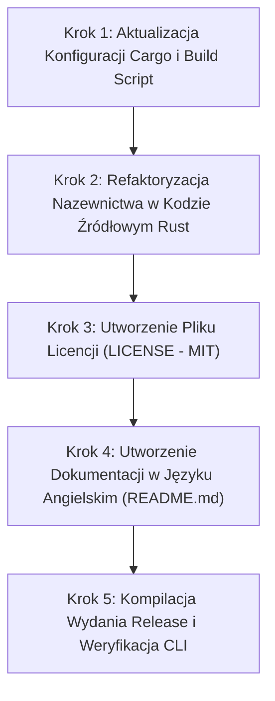

# Szczegółowy Plan Wdrożenia: Rebranding na „TaskbarUnlocked”

Dokument zawiera kompletny, techniczny plan migracji projektu z nazwy roboczej na docelową markę **TaskbarUnlocked**, aktualizacji identyfikatorów systemowych w kodzie Rust oraz przygotowania dokumentacji (`README.md` w języku angielskim wraz z licencją MIT, miejscem na zrzuty ekranu, zastrzeżeniem Microsoft Disclaimer i specyfikacją testowanego środowiska Windows).

---

## 1. Architektura i Przepływ Wdrożenia



---

## 2. Harmonogram Zadań i Konkretne Ścieżki

### Krok 1: Konfiguracja Pakietu Cargo i Linkera

* **Plik 1:** `Cargo.toml`
  * **Cel:** Zmiana nazwy pakietu, biblioteki hookującej oraz pliku wykonywalnego.
  * **Ścieżka:** `c:\Users\vipluk\.gemini\antigravity-ide\scratch\win11-taskbar-unpinner\Cargo.toml`
  * **Zakres zmian:**
    ```toml
    [package]
    name = "taskbar-unlocked"
    version = "0.5.0"
    edition = "2021"

    [lib]
    name = "taskbar_unlocked_hook"
    path = "src/lib.rs"
    crate-type = ["cdylib"]

    [[bin]]
    name = "taskbar-unlocked"
    path = "src/main.rs"
    ```
* **Plik 2:** `build.rs`
  * **Cel:** Aktualizacja powiązania manifestu zasobów Windows z nową nazwą binarki.
  * **Ścieżka:** `c:\Users\vipluk\.gemini\antigravity-ide\scratch\win11-taskbar-unpinner\build.rs`
  * **Linia 144:**
    ```rust
    println!("cargo:rustc-link-arg-bin=taskbar-unlocked={}", manifest_path.display());
    ```
* **Polecenie weryfikujące po Kroku 1:**
  ```powershell
  cargo check --bin taskbar-unlocked
  ```

---

### Krok 2: Refaktoryzacja Identyfikatorów Systemowych w Kodzie Rust

Zmiana nazwy musi objąć rejestr Windows, sekcje pamięci współdzielonej (SHM), klasy okien komunikatów oraz nazwy instalowanych plików.

* **Plik 1: `src/ipc.rs`**
  * Zmiana nazwy obiektu pamięci współdzielonej (Shared Memory):
    ```rust
    pub const SHM_NAME: windows::core::PCWSTR = w!("Local\\TaskbarUnlockedShm_v1");
    pub const SHM_NAME_LEGACY_V6: windows::core::PCWSTR = w!("Local\\Win11TaskbarUnpinnerShm_v6");
    ```

* **Plik 2: `src/installer.rs`**
  * Zmiana kluczy rejestru, katalogu instalacyjnego i osadzanej biblioteki DLL:
    ```rust
    const REG_APP_KEY: PCWSTR = w!("Software\\TaskbarUnlocked");
    const REG_RUN_VAL_NAME: PCWSTR = w!("TaskbarUnlocked");
    const EMBEDDED_HOOK_DLL: &[u8] = include_bytes!("../target/release/taskbar_unlocked_hook.dll");
    ```
  * Funkcja `get_install_dir()`:
    ```rust
    Ok(PathBuf::from(local_app_data).join("TaskbarUnlocked"))
    ```
  * Aktualizacja sprawdzania procesów oraz kopiowania plików binarnych:
    ```rust
    let target_exe = install_dir.join("taskbar-unlocked.exe");
    let target_dll = install_dir.join("taskbar_unlocked_hook.dll");
    ```

* **Plik 3: `src/context_menu.rs`**
  * Ścieżka rejestru: `w!("Software\\TaskbarUnlocked")`
  * Domyślna ścieżka do uruchomienia GUI konfiguratora:
    ```rust
    local_app_data
        .join("TaskbarUnlocked")
        .join("taskbar-unlocked.exe");
    ```

* **Plik 4: `src/watcher.rs` oraz `src/injector.rs`**
  * Nazwy klas okien pomocniczych:
    ```rust
    let class_name = w!("TaskbarUnlockedMsgWnd");
    // Window title:
    w!("TaskbarUnlockedWatcher")
    ```
  * Zmiana sprawdzanych i ładowanych plików biblioteki hooka:
    ```rust
    let local_dll = dir.join("taskbar_unlocked_hook.dll");
    let installed_dll = install_dir.join("taskbar_unlocked_hook.dll");
    ```
  * `src/injector.rs` (linia 63):
    ```rust
    .unwrap_or("taskbar_unlocked_hook.dll");
    ```

* **Plik 5: `src/main.rs`**
  * Definicja parsera argumentów CLI:
    ```rust
    #[command(
        name = "taskbar-unlocked",
        about = "TaskbarUnlocked - Freely drag and position Windows 11 taskbar on any monitor"
    )]
    ```

* **Polecenie weryfikujące po Kroku 2:**
  ```powershell
  cargo check --all-targets
  ```

---

### Krok 3: Utworzenie Pliku Licencji (`LICENSE`)

* **Ścieżka:** `c:\Users\vipluk\.gemini\antigravity-ide\scratch\win11-taskbar-unpinner\LICENSE`
* **Format:** Pełna licencja **MIT** z rokiem 2026.
* **Treść:**
  ```text
  MIT License

  Copyright (c) 2026 TaskbarUnlocked Contributors

  Permission is hereby granted, free of charge, to any person obtaining a copy
  of this software and associated documentation files (the "Software"), to deal
  in the Software without restriction, including without limitation the rights
  to use, copy, modify, merge, publish, distribute, sublicense, and/or sell
  copies of the Software, and to permit persons to whom the Software is
  furnished to do so, subject to the following conditions:

  The above copyright notice and this permission notice shall be included in all
  copies or substantial portions of the Software.

  THE SOFTWARE IS PROVIDED "AS IS", WITHOUT WARRANTY OF ANY KIND, EXPRESS OR
  IMPLIED, INCLUDING BUT NOT LIMITED TO THE WARRANTIES OF MERCHANTABILITY,
  FITNESS FOR A PARTICULAR PURPOSE AND NONINFRINGEMENT. IN NO EVENT SHALL THE
  AUTHORS OR COPYRIGHT HOLDERS BE LIABLE FOR ANY CLAIM, DAMAGES OR OTHER
  LIABILITY, WHETHER IN AN ACTION OF CONTRACT, TORT OR OTHERWISE, ARISING FROM,
  OUT OF OR IN CONNECTION WITH THE SOFTWARE OR THE USE OR OTHER DEALINGS IN THE
  SOFTWARE.
  ```

---

### Krok 4: Przygotowanie Dokumentacji `README.md` w Języku Angielskim

* **Ścieżka:** `c:\Users\vipluk\.gemini\antigravity-ide\scratch\win11-taskbar-unpinner\README.md`
* **Katalog na zasoby graficzne:** `docs/screenshots/`
* **Zawartość i struktura dokumentu:**
  1. **Header & Badges:**
     * Project Name: `# 🔓 TaskbarUnlocked`
     * Tagline: *Unlock and freely drag the Windows 11 taskbar to any screen edge across all monitors.*
     * Badges: `License: MIT`, `Platform: Windows 11`, `Language: Rust`.
  2. **Preview & Screenshots (miejsca na zrzuty ekranu):**
     * Zrzut ekranu okna ustawień: ``
     * Zrzut ekranu menu kontekstowego paska zadań: ``
  3. **Key Features:**
     * Direct mouse drag-and-drop to Top, Left, Right, Bottom edges.
     * **Full Multi-Monitor Freedom:** Drag or assign taskbar to secondary or external screens.
     * Native Windows 11 Shell Context Menu Integration (*Lock the taskbar* / *Advanced taskbar settings*).
     * Written purely in high-performance native Rust (no Electron, no web views, lightweight memory footprint).
  4. **Tested Environment:**
     * Dokładna specyfikacja testowa na podstawie maszyny deweloperskiej:
       * **Operating System:** Microsoft Windows 11
       * **Version / Release:** 26H2
       * **OS Build:** 26340.9767
       * **Architecture:** x86_64
  5. **Installation & Usage:**
     * Standard run, `--install`, `--uninstall`, `--gui`.
  6. **Legal Disclaimer (Microsoft Disclaimer):**
     * *TaskbarUnlocked is an independent open-source project and is not affiliated with, authorized, maintained, sponsored, or endorsed by Microsoft Corporation or any of its affiliates. Windows, Windows 11, and Taskbar are registered trademarks of Microsoft Corporation.*
  7. **License:**
     * MIT License.

---

### Krok 5: Kompilacja i Końcowa Weryfikacja Techniczna

1. **Budowa biblioteki hooka i pliku wykonywalnego:**
   ```powershell
   cargo build --release
   ```
2. **Weryfikacja wygenerowanych plików:**
   * `target/release/taskbar_unlocked_hook.dll`
   * `target/release/taskbar-unlocked.exe`
3. **Test poprawności działania parametrów CLI:**
   ```powershell
   .\target\release\taskbar-unlocked.exe --help
   ```

