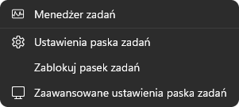
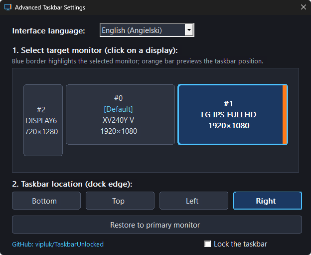

# TaskbarUnlocked 🔓

[](https://www.microsoft.com/windows)
[-blue.svg)](#tested-system-environments)
[](https://www.rust-lang.org/)
[](LICENSE)

> **Unlock and freely drag the Windows 11 taskbar to any screen edge across all monitors.**

Windows 11 removed the ability to drag and position the taskbar to different edges of the screen and locked secondary displays into rigid layouts. **TaskbarUnlocked** restores complete freedom: click and drag the taskbar to the top, bottom, left, or right edges of your primary monitor or **any** connected secondary display.

---

## Previews

| Taskbar Context Menu | Application Settings |
| :---: | :---: |
|  |  |
| *Native right-click menu integration ("Lock the taskbar")* | *Interactive multi-monitor edge picker & real-time preview* |

---

## Features

* **Free Drag & Drop:** Click and drag the taskbar directly between screen edges (Bottom, Top, Left, Right) with a smooth live docking preview overlay and a 24 px deadzone to prevent accidental drags.
* **Full Multi-Monitor Freedom:** Relocate the primary taskbar to **any** display, not just the primary monitor, with EDID hardware monitor name detection.
* **Native XAML Context Menu Integration:** Restores the classic *"Lock the taskbar"* toggle (with checkmark state) and *"Advanced taskbar settings"* directly inside the Windows 11 XAML right-click menu (localized across 38 Windows languages).
* **Ultra Lightweight & Non-Destructive:** Crafted 100% in native **Rust** with direct Win32 API bindings. Zero Electron, zero web views, negligible RAM/CPU footprint, and **zero modified system files on disk**.


---

## Tested System Environments

This application has been verified and tested on real hardware across both official Windows 11 production builds and Windows Insider channels:

| Environment | Edition | Feature Release | OS Build | Kernel / Experience Pack |
| :--- | :--- | :--- | :--- | :--- |
| **Official Release (Production)** | Windows 11 Home | **26H2** | **26300.9818** | Feature Experience Pack 1000.26100.385.0 |
| **Windows Insider Preview** | Windows 11 Pro / Insider | **26H2** | **26340.9767** | Kernel 10.0.26340.9767 |

> [!NOTE]
> Conceived, directed, and tested on real hardware by human oversight, with the entire codebase implemented by advanced AI reasoning models primarily from Google alongside Anthropic (no OpenAI models were used).

---

## Installation

### Option 1: Single-File Interactive Installer (Recommended)
1. Download the latest `taskbar-unlocked.exe` from the [Releases](../../releases) tab (the hook DLL is embedded directly inside the `.exe`).
2. **Double-click `taskbar-unlocked.exe`**:
   * On first run, it automatically installs into `%LOCALAPPDATA%\TaskbarUnlocked`, registers instant logon autostart, and unlocks your taskbar.
   * When run again while already installed, an interactive prompt lets you choose:
     * **[Yes]** — Perform a full clean reinstall (uninstalls the previous version, restarts `explorer.exe`, and installs the new build).
     * **[No]** — Completely uninstall the application and restore the native Windows taskbar to its original pre-install state.
     * **[Cancel]** — Exit immediately without making any changes.
3. Right-click the taskbar to toggle **"Lock the taskbar"** or open **"Advanced taskbar settings"** to configure monitors and edges via the dark-mode GUI.

### Option 2: Command Line Usage
You can also control `taskbar-unlocked.exe` via CLI flags:

```powershell
# Open the Dark-Mode Graphical Configuration Window
.\taskbar-unlocked.exe --gui

# Move taskbar to Top edge on Monitor 1 (one-shot)
.\taskbar-unlocked.exe --monitor 1 --edge top --once

# List all connected monitors, their indices, DPI, and resolutions
.\taskbar-unlocked.exe --list

# Run in background daemon mode
.\taskbar-unlocked.exe --daemon

# Force silent install or uninstall
.\taskbar-unlocked.exe --install
.\taskbar-unlocked.exe --uninstall

# Restore taskbar to primary monitor or full factory baseline
.\taskbar-unlocked.exe --restore
.\taskbar-unlocked.exe --restore-baseline
```

---

## Building from Source

Prerequisites:
* [Rust](https://rustup.rs/) (stable toolchain)
* MSVC Build Tools for Windows (C++ workload)

```powershell
# 1. Clone the repository
git clone https://github.com/vipluk/TaskbarUnlocked.git
cd TaskbarUnlocked

# 2. Build the hook DLL and the main executable (Release mode)
cargo build --release --lib
cargo build --release --bin taskbar-unlocked

# 3. Binaries will be generated in target/release/:
# - taskbar-unlocked.exe
# - taskbar_unlocked_hook.dll
```

---

## Legal Disclaimer

> **IMPORTANT:**  
> **TaskbarUnlocked** is an independent open-source project and is **not** affiliated with, sponsored by, authorized by, maintained by, or endorsed by **Microsoft Corporation** or any of its subsidiaries or affiliates.  
> 
> *Windows*, *Windows 11*, *Microsoft*, and *Taskbar* are registered trademarks of Microsoft Corporation. All other trademarks, registered trademarks, product names, and company names mentioned in this project are the property of their respective owners.

---

## License

This project is licensed under the **GNU General Public License v2.0 (GPL-2.0)** - see the [LICENSE](LICENSE) file for full details.

